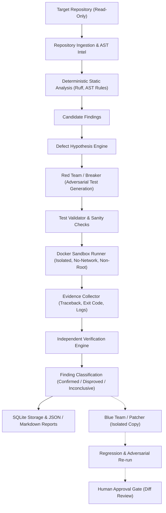

# System Architecture (ARCHITECTURE.md)

## 1. High-Level System Overview

The **Evidence-Gated Adversarial Multi-Agent Code Reviewer** is a reliability-first automated review system. It replaces unverified AI commentary with a closed-loop verification pipeline where potential defects must be proven through adversarial test generation and isolated execution.



---

## 2. Logical Agent & Component Responsibilities

1. **Repository Intelligence Agent (`adversary.repository` & `adversary.analysis.ast`)**:
   - Safe file discovery with path traversal and symlink guards.
   - AST extraction: modules, imports, classes, functions, docstrings, call graphs, and tests.
   - Computes source content hashes (SHA-256) to detect stale evidence.

2. **Static Analysis Component (`adversary.analysis.static`)**:
   - Invokes deterministic analyzers (e.g. Ruff rules, AST pattern detectors).
   - Normalizes diagnostics into standard `CandidateFinding` schemas.

3. **Defect Hypothesis Engine (`adversary.hypotheses`)**:
   - Translates suspicious patterns or static diagnostics into formal testable hypotheses.
   - Identifies input precondition, trigger mechanism, expected behavior, and defect behavior.

4. **Red Team / Breaker Agent (`adversary.test_generation`)**:
   - Produces targeted test suites aimed at proving the hypothesis.
   - Uses property testing (Hypothesis), edge-case boundary testing, and exception-path probes.
   - Syntactically and semantically validates generated tests before execution.

5. **Sandbox Manager (`adversary.sandbox`)**:
   - Manages container lifecycle with strict security limits:
     - Read-only source mounting.
     - Ephemeral, restricted writable directories for test execution output.
     - Non-root container UID.
     - `--network none` by default.
     - CPU, memory, and timeout bounds.

6. **Evidence Collector (`adversary.evidence`)**:
   - Gathers execution results: exit codes, standard output, standard error, parsed stack traces, execution duration, and environment fingerprints.
   - Preserves traceability back to the originating hypothesis and test.

7. **Independent Verification Agent (`adversary.verification`)**:
   - Attributions analysis: verifies that the exception/failure occurred in the target code and not due to test runner syntax errors, harness failures, or environment missing dependencies.
   - Evaluates whether observed behavior violates the expected contract.
   - Assigns unambiguous outcomes: `CONFIRMED`, `DISPROVED`, `INCONCLUSIVE`, `UNVERIFIED`, or `EXECUTION_ERROR`.

8. **Blue Team / Patcher Agent (`adversary.patching`)**:
   - Generates minimal localized patches for confirmed defects.
   - Applies patches exclusively to an isolated temporary working copy.
   - Requires adversarial test to turn from FAILING to PASSING and existing regression suite to PASS.
   - Strictly enforces a human approval barrier before any modification reaches the target repository.

9. **Central Orchestrator (`adversary.orchestration`)**:
   - Drives workflow states, enforces concurrency budgets, manages timeouts and checkpoints, and guarantees consistent state persistence.

10. **Persistence & Reporting (`adversary.persistence` & `adversary.reporting`)**:
    - Stores complete run history and evidence links in SQLite.
    - Generates actionable Markdown summaries and machine-readable JSON reports.

---

## 3. Package and Source Layout

```text
src/adversary/
├── __init__.py
├── cli/               # Typer CLI commands & Rich formatters
├── core/              # Errors, interfaces, logging, utilities
├── config/            # Pydantic Settings & configuration models
├── models/            # Domain schemas (Finding, Hypothesis, Evidence, Test, Patch)
├── repository/        # File scanner, path guards, git inspection
├── analysis/
│   ├── ast/           # Python AST parser, symbol table, call extractor
│   ├── static/        # Ruff adapter & deterministic rule engines
│   └── security/      # Deterministic security vulnerability checks
├── hypotheses/        # Defect hypothesis generator & validator
├── test_generation/   # Red Team test generators & syntax validators
├── sandbox/           # Docker container manager & execution runner
├── evidence/          # Output parser, stack trace extractor, collector
├── verification/      # Independent verification engine & decision logic
├── orchestration/     # Central state machine & workflow coordinator
├── patching/          # Blue team patch generator, isolator & regression runner
├── persistence/       # SQLite database, schema migrations & repositories
└── reporting/         # Markdown & JSON report formatters
```
